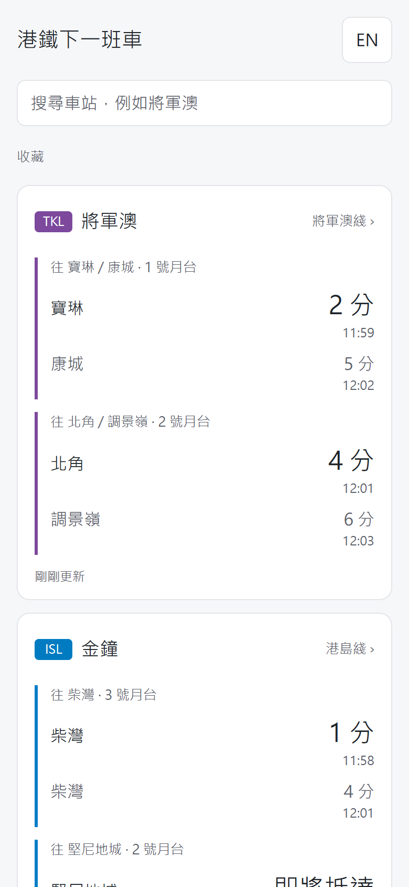
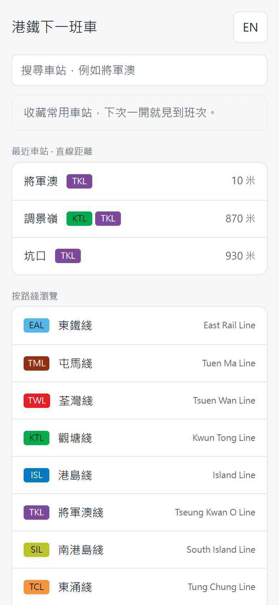
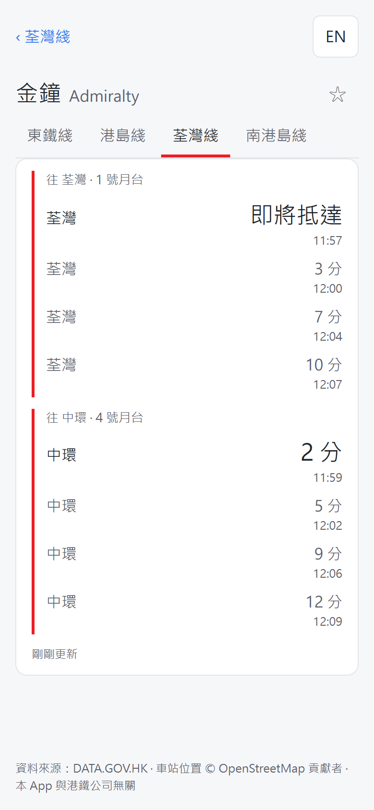
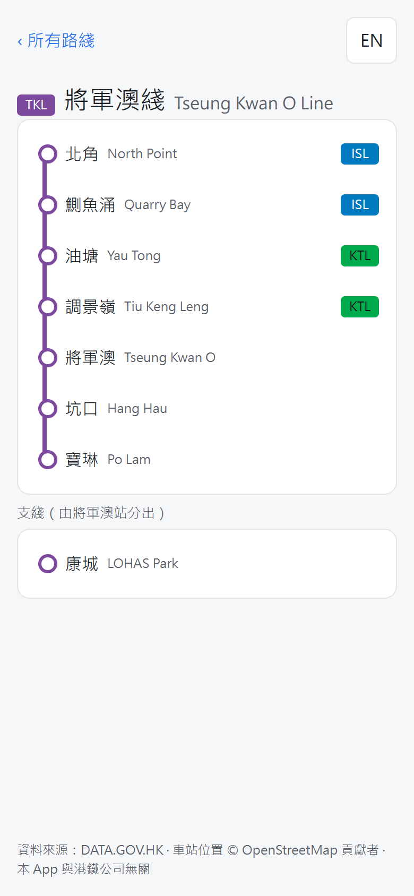
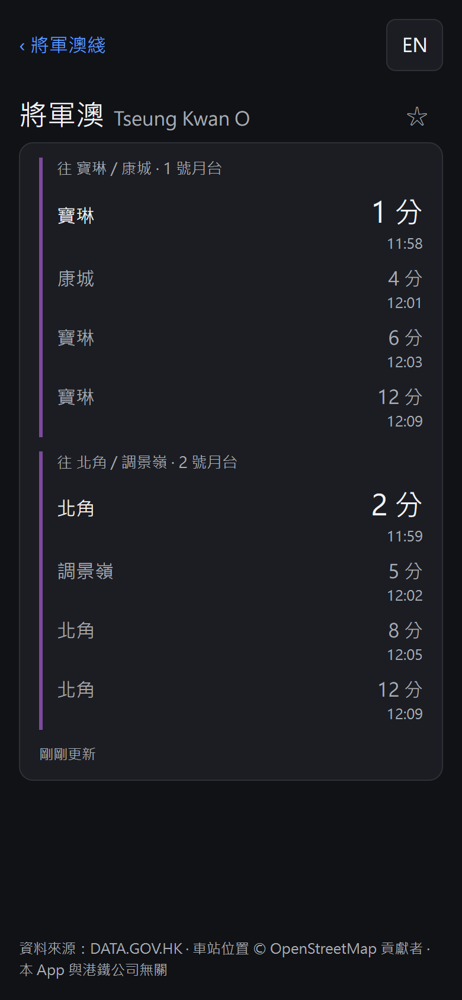
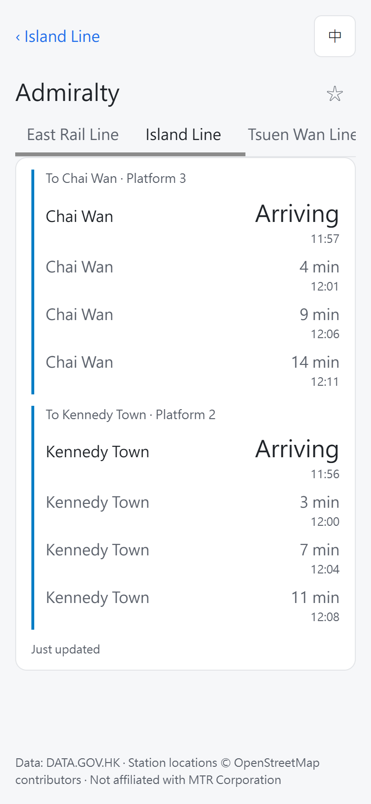

# 港鐵下一班車 MTR Next Train

查詢港鐵重鐵各站下一班車的 Web App，為手機而設計，打開即見常用車站的班次。

A mobile-first web app showing real-time next-train times for Hong Kong MTR heavy rail, in Chinese and English.

**線上版：** https://cracking2.github.io/mtr-next-train/

> 本 App 與港鐵公司無關。

## 截圖

| 首頁（收藏） | 最近車站 | 車站（轉車站分路綫） |
|---|---|---|
|  |  |  |

| 路綫圖（含支綫） | 深色模式 | 英文介面 |
|---|---|---|
|  |  |  |

## 功能

- **即時班次**：每個方向最多 4 班車，顯示目的地、月台、分鐘倒數及到站時間；每 15 秒自動更新。
- **收藏常用站**：按「車站 + 路綫」收藏，首頁直接顯示班次；可復原。
- **搜尋**：中文名、英文名或車站代號（例如「將軍」、「tseung」、「TKO」）。
- **定位最近車站**：列出最近 3 個站及直線距離；位置只在裝置上計算，不會傳送。
- **按路綫瀏覽**：垂直路綫圖，標示轉車站及支綫。
- **中英切換**：介面、站名、錯誤訊息一併切換，並記住選擇。
- **狀態處理**：載入中、延誤提示、非服務時間、網絡錯誤、資料過時（保留上一次班次並提示重新載入）、定位權限被拒。
- **深色模式**：跟隨系統設定。

## 技術棧

| 部分 | 選擇 |
|---|---|
| 介面 | React 19 + TypeScript（strict） |
| 建置 | Vite |
| 數據抓取 | TanStack Query（輪詢、重試、失敗時保留舊資料） |
| 路由 | 自寫 hash 路由（GitHub Pages 不支援路徑改寫） |
| 樣式 | 純 CSS 變數，淺色及深色兩套 token |
| 部署 | GitHub Actions → GitHub Pages（push 到 `main` 即自動 lint、build、部署） |

不需要後端：班次 API 已開放 CORS，瀏覽器可直接呼叫。

## 資料來源

| 資料 | 來源 | 使用方式 |
|---|---|---|
| 實時班次 | [DATA.GOV.HK 港鐵下一班列車到站時間](https://data.gov.hk/) `rt.data.gov.hk/v1/transport/mtr/getSchedule.php` | 瀏覽器即時呼叫 |
| 車站名單 | [港鐵開放數據](https://opendata.mtr.com.hk/data/mtr_lines_and_stations.csv) | `npm run data` 轉成 `src/data/stations.json` |
| 車站座標 | © [OpenStreetMap](https://www.openstreetmap.org/copyright) 貢獻者（ODbL） | `npm run coords` 轉成 `src/data/coords.json` |
| 路綫顏色 | Wikipedia「Module:Adjacent stations/MTR」 | 寫在 `src/data/lines.ts` |

## 假設與限制

- **用戶需要未經驗證。** 三個 persona（固定車站的通勤者、不熟路綫的訪客、身處陌生地點的人）是假設，未做用戶訪問。
- **班次是估算。** API 本身只準到分鐘，所以 App 只顯示分鐘，不跳秒。
- **倒數以裝置時間計算。** 實測 API 的 `curr_time` 比裝置時間慢 10–15 秒，用它計算會令每班車多報 10–15 秒。
- **API 的 `lang` 參數不會翻譯站名。** 目的地永遠是站代號，所以中英站名來自港鐵車站名單。
- **路綫顏色不是官方來源。** 取自 Wikipedia 並已計算對比度；港島綫、荃灣綫、機場快綫的徽章底色略為調深，以達到 WCAG AA。
- **最近車站用直線距離**，不是步行距離。
- **只涵蓋重鐵 10 條路綫。** 不包括輕鐵、港鐵巴士及路線規劃。

## 開發

```bash
npm install
npm run dev
```

| 指令 | 用途 |
|---|---|
| `npm run build` | 型別檢查及建置 |
| `npm run lint` | oxlint |
| `npm run data` | 重新產生車站名單 |
| `npm run coords` | 重新產生車站座標（Overpass 主伺服器繁忙時自動改用鏡像） |
| `npm run screenshots` | 用 Chrome DevTools Protocol 由線上版重新影 README 截圖 |

## 專案文件

- [產品簡介 product brief](docs/product-brief.md)：問題、用戶、範圍、里程碑，以及 API 實測結果
- [UI/UX 與色彩計劃](docs/ui-ux-plan.md)：畫面規格、色彩 token、對比度、狀態設計
- [Lovable MVP prompt](docs/lovable-prompt.md)：用 Lovable 重建 MVP 的濃縮指示
